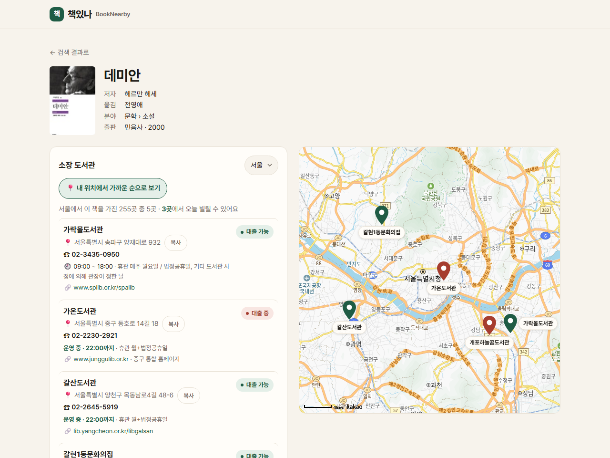
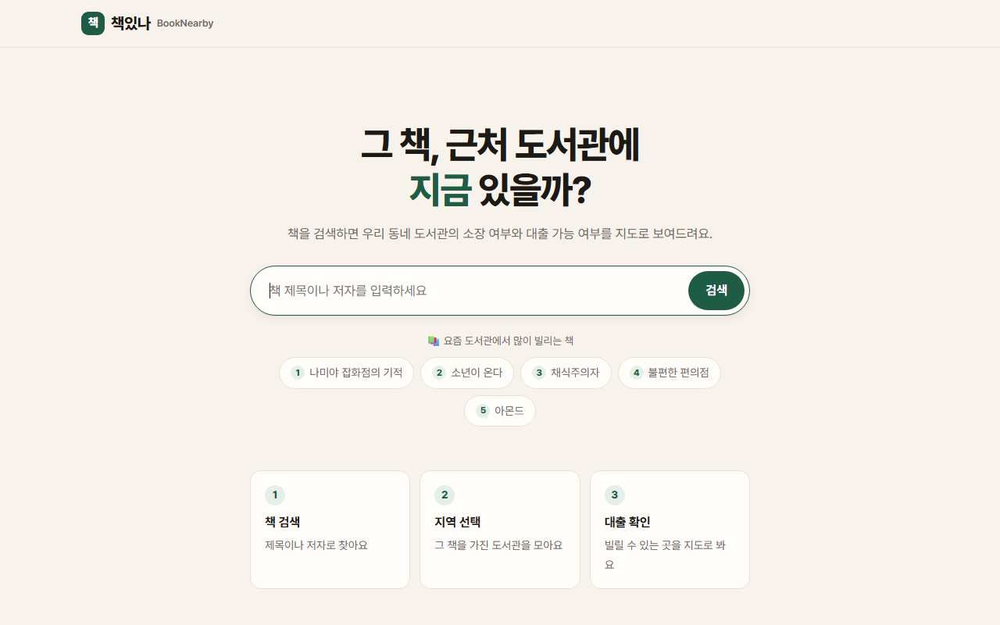
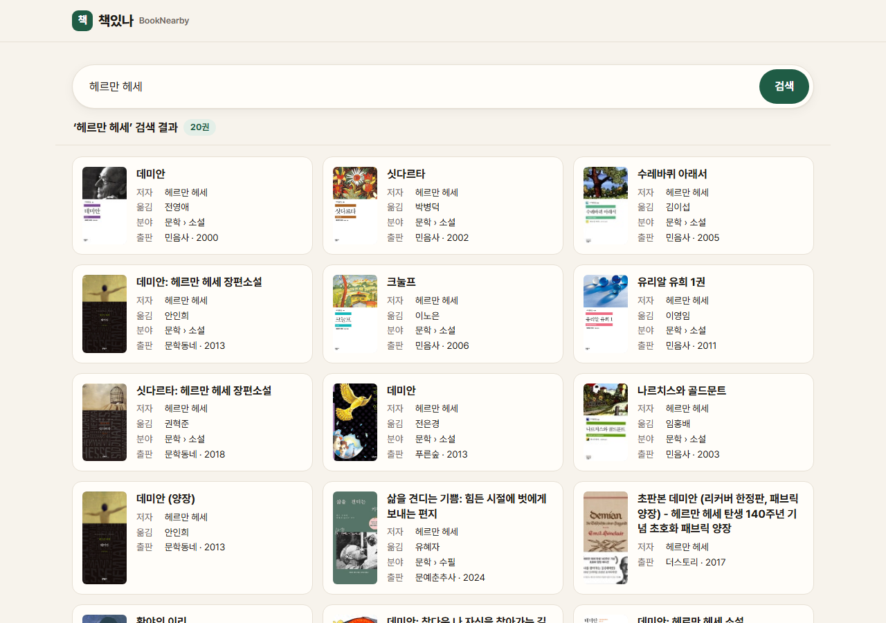
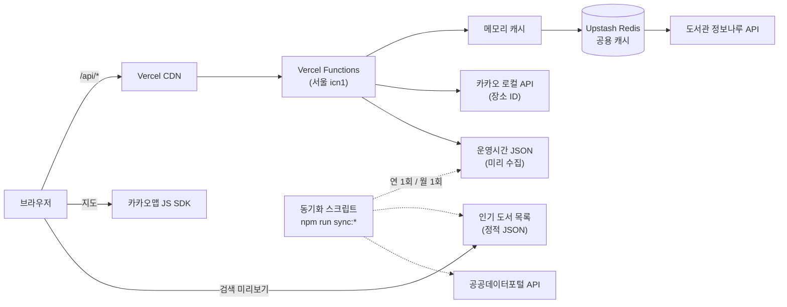

# 📚 책있나 (BookNearby)

> **그 책, 근처 도서관에 지금 있을까?**
> 책을 검색하면 내 주변 도서관 중 그 책을 가진 곳과 **지금 빌릴 수 있는지**, **오늘 문을 여는지**를 지도로 보여주는 웹 서비스입니다.

🔗 **사이트**: https://book-nearby.vercel.app



<br>

## 주요 기능

| 첫 화면 | 검색 결과 |
|---|---|
|  |  |

- **책 검색**: 제목이나 저자로 찾아요. 입력하는 동안 인기 도서 미리보기가 뜨고(API 호출 0건), 최근 검색어를 기억해요.
- **소장 도서관 + 대출 가능 여부**: 내 위치에서 가까운 도서관 순으로, 지금 빌릴 수 있는지 보여줘요.
- **오늘 운영 여부**: "운영 중 · 22:00까지", "오늘 휴관"처럼 지금 가도 되는지 알려줘요.
- **지도 연동**: 대출 가능(초록)·대출 중(빨강) 마커, 마커와 목록 양방향 선택, 카카오맵 길찾기·장소 정보 바로가기
- **다른 지역 안내**: 고른 지역에 그 판본이 없으면 "경기 8곳 · 대전 5곳"처럼 있는 지역을 알려줘요.
- **바로 쓰는 정보**: 주소 복사, 전화 걸기, 도서관 홈페이지(구 통합 사이트인지 구분)

<br>

## 기술 스택

| 영역 | 기술 |
|---|---|
| 프론트엔드 | React 19, TypeScript, Vite, React Router, TanStack Query |
| 서버 | Vercel Functions (Node.js, 서울 리전 `icn1`) — API 키를 숨기는 프록시이자 여러 API를 합치는 곳 |
| 캐시 | 서버 메모리 → Upstash Redis(공용) → Vercel CDN |
| 지도 | 카카오맵 JavaScript SDK, 카카오 로컬 API |
| 데이터 | 도서관 정보나루 Open API, 공공데이터포털 전국도서관표준데이터 |
| 테스트 | Vitest (16개 파일, 147개 테스트) |

<br>

## 구조



**데이터 성격에 따라 가져오는 방식을 나눴습니다.**

| 데이터 | 바뀌는 빈도 | 가져오는 방식 |
|---|---|---|
| 대출 가능 여부 | 수시 | 요청마다 호출, 캐시 1시간 |
| 검색 결과 · 소장 도서관 목록 · 책 정보 | 드묾 | 요청마다 호출, 캐시 하루 |
| 운영시간 · 휴관일 | 연 1회 | 스크립트로 전체 수집 → JSON으로 저장 (`npm run sync:hours`) |
| 인기 대출 도서 (검색 미리보기) | 월 단위 | 스크립트로 5,000권 수집 → 정적 파일 (`npm run sync:popular`) |
| 구·시 통합 홈페이지 목록 | 드묾 | 스크립트로 전국 1,632곳 수집 (`npm run sync:homepages`) |

<br>

## 🛠 문제 해결 기록

만들면서 실제로 부딪힌 문제와 해결 과정입니다.

### 1. "어린 왕자"를 검색했는데 『어린 왕자』가 안 나온다
- **문제**: 검색 결과 1,104권 중에 정작 『어린 왕자』가 없고, 『아드님, 진지 드세요』, 『해리포터』 등이 섞여 나왔어요.
- **원인**: 정보나루 키워드 검색은 검색어를 단어로 쪼개서("어린", "왕자") 아무 데나 들어간 책을 대출 많은 순으로 줘요.
- **해결**: **제목 검색과 저자 검색을 동시에** 하고, 결과가 더 많은 쪽을 위에 보여줘요. 결과가 많은 쪽이 사용자가 의도한 검색이기 때문이에요. 둘 다 없을 때만 키워드 검색을 해요.
- **결과**: "어린 왕자"(제목 964 / 저자 0) → 『어린 왕자』, "헤르만 헤세"(제목 124 / 저자 832) → 데미안·싯다르타가 위에 나와요.

### 2. 정보나루 하루 500건 한도와 배포 환경
- **문제**: 정보나루는 IP 등록 전 하루 500건 한도가 있는데, 상세 화면 하나에 여러 번 호출해야 해요(소장 도서관 + 도서관마다 대출 여부). 게다가 배포 서버(Vercel)는 IP가 고정되지 않아 등록할 수 없어요.
- **해결**
  - **캐시 3단계**: 서버 메모리 → 공용 Redis → 정보나루. 메모리는 서버마다 따로라 Vercel에서 금방 비워져서, 모든 서버가 같이 쓰는 Redis를 뒀어요. 동시에 들어온 같은 요청은 한 번만 불러요.
  - **지난 결과로 버티기**: Redis에 7일 보관해서, 정보나루가 실패하면 검색·소장 도서관 목록은 지난 결과를 보여줘요. **대출 여부는 제외**했어요. 지난 값이 헛걸음을 만들 수 있어서요.
  - **호출 수 줄이기**: 대출 여부는 가까운 5곳만, 위치는 1km 단위로 반올림해 근처 사용자끼리 CDN 캐시를 공유해요. 검색 미리보기는 인기 도서를 미리 받아 둔 목록에서만 찾아요(입력 중 호출 0건).
  - **한도 초과 안내**: 일반 오류 대신 "오늘 조회 가능한 횟수를 모두 사용했어요"(HTTP 429)를 보여줘요.
- **남은 과제**: 배포 서버에서 "인증정보 불일치" 응답이 나와, 정보나루 IP 등록 정책과 Vercel의 유동 IP가 맞지 않는 문제를 정리하고 있어요.

### 3. 브라우저가 1시간 전 대출 정보를 보여준다
- **문제**: 코드를 고쳐도 화면에 예전 결과가 계속 나왔어요.
- **원인**: CDN용으로 넣은 `Cache-Control: s-maxage=…, stale-while-revalidate=…`의 `stale-while-revalidate`가 **사용자 브라우저에도 적용**돼서, 브라우저가 오래된 응답을 먼저 보여주고 있었어요. 배포 후에는 오래된 대출 정보를 보여줄 수 있는 문제였어요.
- **해결**: 헤더를 나눴어요. 브라우저는 `Cache-Control: no-cache`(매번 확인), CDN만 `Vercel-CDN-Cache-Control`로 저장해요. 배포 후 `X-Vercel-Cache: HIT`로 CDN 캐시가 동작하는 것도 확인했어요.

### 4. 운영시간 데이터: 코드가 다른 두 데이터 합치기
- **문제**: "대출 가능"이어도 오늘 휴관이면 헛걸음이라 운영시간이 필요했는데, 정보나루에는 시간 정보가 부족하고, 공공데이터(전국도서관표준데이터)는 **도서관 코드 체계가 달라** 바로 합칠 수 없었어요.
- **해결**: 좌표 300m 이내 + 이름으로 짝을 찾아요. 같은 건물의 어린이도서관을 잘못 고르지 않도록, 이름이 겹치면 300m, 이름이 달라도 100m 안이면 같은 곳으로 봐요. 연 1회 바뀌는 데이터라 요청마다 부르지 않고 스크립트로 받아 JSON으로 저장해요.

### 5. 제각각인 휴관일 표기 해석
- **문제**: 휴관일이 `금+1월1일+설 연휴`, `셋째 주 월`, `매주토, 일요일`, `매월 첫 번째, 세 번째 월요일`처럼 정해진 형식이 없었어요. 특히 `일요일을 제외한 법정공휴일`에는 "일요일"이 들어 있지만 일요일이 휴관이라는 뜻이 아니에요.
- **해결**: 실제 3,657곳의 표기를 모아 패턴을 분석하고, 요일·주차·제외 표현을 읽는 해석기를 만들었어요. 실제 표기 예시를 그대로 테스트로 만들었어요.
- **결과**: 요일 규칙이 있는 **3,370곳**을 해석해요. 공간마다 시간이 다른 운영시간 글("자료실 09~22시, 열람실 07~22시")은 잘못 읽으면 헛걸음하게 만들 수 있어서 일부러 해석하지 않고 원문을 보여줘요.

### 6. 카카오맵 "정보보기"를 정확한 장소로 연결하기
- **문제**: 카카오 로컬 API로 도서관 장소를 찾으면, 같은 건물의 구내식당·주차장이 먼저 나오거나 이름이 달라서(정보나루 "강남구립도곡정보문화도서관" ↔ 카카오 "도곡정보문화도서관") 못 찾았어요. 정보나루 좌표가 실제 위치에서 **1.86km** 벗어난 도서관도 있었어요.
- **해결**: 단계적으로 찾아요. ① 이름이 똑같은 곳 → ② "○○구립" 같은 꾸밈말을 뗀 이름 → ③ 반경을 5km로 넓히되 이름이 똑같은 곳만 인정해요. 화장실·주차장은 분류로 걸러내요.
- **결과**: 서울 108곳 기준 연결률을 **87% → 94%**로 올렸고, 못 찾으면 검색 링크로 대신해요.

### 7. 가까이 붙은 마커가 눌리지 않는다
- **문제**: 도서관 두 곳이 붙어 있으면, 선택된 도서관의 이름표와 정보 카드가 옆 마커를 덮어서 눌리지 않았어요.
- **원인**: 이름표가 마커 위에 그려지는 데다, 카카오가 정보 카드를 감싸는 **투명한 상자가 카드 아래 여백(48px)까지** 클릭을 가로채고 있었어요.
- **해결**: 이름표가 다른 이름표·마커를 피해 아래 → 오른쪽 → 왼쪽 → 위 순으로 자리를 잡게 하고(모두 막히면 숨김), 투명 상자는 클릭을 통과시켰어요. 마커 중심에 무엇이 맨 위에 있는지 직접 검사해서 확인했어요.

### 8. "이 책을 가진 도서관이 없어요"인데 실제로는 있다
- **문제**: 『어린 왕자』는 판본이 수십 개라, 사용자가 고른 판본이 서울에 없을 수 있어요. 사용자는 지역을 하나씩 바꿔 봐야 했어요.
- **해결**: 고른 지역에 없을 때만 17개 시·도를 동시에 조회해서(개수만 필요해 `pageSize=1`) "경기 8곳 · 대전 5곳" 버튼을 보여줘요. 누르면 그 지역으로 바로 바뀌어요.

### 9. 휴대폰에서 상세 화면이 화면 밖으로 넘친다
- **문제**: 320~390px 휴대폰에서 상세 화면이 426px로 넘쳤어요. 미리보기 도구의 화면 너비가 실제와 달라서 처음에는 놓쳤어요.
- **원인**: 모바일 그리드를 `1fr`로 줬는데, `1fr`은 **내용의 최소 너비보다 작아지지 않아요.** 줄바꿈 안 되는 긴 홈페이지 주소가 칸을 넓혔어요.
- **해결**: `minmax(0, 1fr)`로 바꾸고, 정확한 너비의 틀에 페이지를 띄워 320·375·390px에서 넘침이 없는 걸 확인했어요.

<br>

## 실행 방법

```bash
cp .env.example .env   # 키 입력
npm install
npm run dev            # http://localhost:5173 (api/ 서버 함수도 함께 동작)
npm test
```

| 환경 변수 | 용도 | 필수 |
|---|---|---|
| `VITE_KAKAO_MAP_KEY` | 카카오맵 JavaScript 키 (브라우저용, 등록 도메인에서만 동작) | ✅ |
| `DATA4LIBRARY_KEY` | 도서관 정보나루. 비어 있으면 목업 데이터로 동작 | ✅ |
| `KAKAO_REST_KEY` | 카카오 로컬 API (도서관 장소 ID) | 선택 |
| `UPSTASH_REDIS_REST_URL` · `_TOKEN` | 공용 캐시. 없으면 메모리 캐시만 사용 (Vercel 연동 시 `KV_*`도 인식) | 선택 |
| `DATA_GO_KR_KEY` | 운영시간 동기화 스크립트 전용 | 스크립트만 |

**데이터 동기화**
```bash
npm run sync:hours       # 운영시간·휴관일 (공공데이터포털, 연 1회)
npm run sync:popular     # 인기 대출 도서 → 검색 미리보기 (월 1회)
npm run sync:homepages   # 구·시 통합 홈페이지 목록
```

<br>

## 폴더 구조

```
api/                  Vercel 서버 함수 (파일 하나 = API 주소 하나)
  search.ts           도서 검색 (제목·저자 동시 검색)
  libraries.ts        소장 도서관 + 대출 여부 + 운영시간 + 장소 ID
  regions.ts          다른 지역 소장 현황
  book.ts             ISBN으로 책 정보 (공유 링크용)
  _lib/               공용 코드 (밑줄 폴더는 주소로 공개되지 않음)
  _data/              미리 수집한 운영시간·통합 홈페이지 JSON
scripts/              데이터 동기화 스크립트
src/
  pages/              검색·상세 화면
  components/         지도, 검색창, 도서관 항목, 책 정보
  hours.ts            휴관일 해석 · 오늘 운영 상태
  suggest.ts          검색 미리보기 · 최근 검색어
public/data/          인기 도서 목록 (검색 미리보기용)
```

<br>

## 앞으로 할 일

- [ ] 배포 환경에서 정보나루 호출 정책 정리 (IP 등록 vs 유동 IP)
- [ ] 내 위치로 지역 자동 선택
- [ ] 법정공휴일 반영 (공공데이터포털 특일 정보)
- [ ] 도서관·검색 결과 더 보기, 찜 기능
